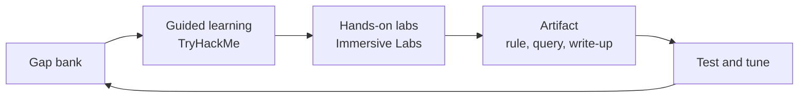

# From Operator to Detection Engineer: A 90-Day Plan

After years of running EDR and SIEM platforms, I've noticed a pattern. Most of the alerts a large fleet produces are noise, and the detections that matter are the ones someone took the time to write, test, and tune. That's the shift I'm working on: moving from operating security tools to building the detections those tools run.

This post lays out the plan I'm using. It's built for someone who already knows the platforms well and needs to close specific technical gaps.

## Where to Start: Honest Gap Assessment

Before choosing resources, write down what you can and can't do today. For me, the gaps were:

- Writing detection logic from scratch, not just consuming vendor rules
- Mapping techniques to MITRE ATT&CK and reasoning about coverage
- Hunting from a hypothesis instead of from an alert
- Container and cloud security beyond the endpoint

Keep this list in one place, such as a "gap bank," and update it weekly. Every learning activity should trace back to an item on it.

## The Learning Stack

Two platforms cover most of the practice work:

- **TryHackMe** for guided paths. Its SOC and MITRE ATT&CK content gives structured fundamentals, so you're not guessing at the order to learn things in.
- **Immersive Labs** for hands-on labs. Use it for detection and hunting exercises, and for cloud and container content.

Platforms are only useful if they produce something. Each completed room or lab should end with a short note: what the technique was, what telemetry it leaves behind, and what a detection would look like.

## The Weekly Rhythm

A workable split for someone with a full-time job:

1. **Two to three guided sessions** on TryHackMe for fundamentals.
2. **Two to three lab sessions** on Immersive Labs, focused on detection or hunting.
3. **One artifact session**, where you turn a learning point into something reusable: a Sigma rule, a LogScale or SIEM query, or a short write-up.

Keep the artifact session fixed on your calendar. It's the easiest one to skip and the one that builds the portfolio.

## Writing Detections the Right Way

A detection is only as good as its testing. For each rule you write:

- State the hypothesis in one sentence: what behavior are you catching, and why does it matter?
- Map it to an ATT&CK technique and sub-technique.
- List the expected false positives before you deploy, not after.
- Test it against both a known-bad simulation and realistic benign activity.
- Record how you'd tune it when it fires too often.

Writing down false positives in advance is the habit that separates a rule from a useful detection.

## How the Cycle Fits Together

Each pass through the loop closes a gap and adds something you can show.

## Tracking Progress

Measure output, not hours. At the end of each month, count:

- Gaps closed in the gap bank
- Detections written, tested, and tuned
- Write-ups published or shared with your team

If the numbers are flat, the problem is usually that the artifact step is being skipped.

## What I'd Do Differently

Start the artifact habit on day one, even if the first rules are simple. Waiting until you feel ready means waiting indefinitely. A basic rule with honest notes on its weaknesses is more valuable than a polished rule you never finish.

---

*Feedback and corrections are welcome. If you're on a similar path, I'd be glad to compare notes.*
