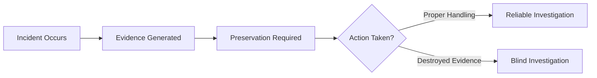
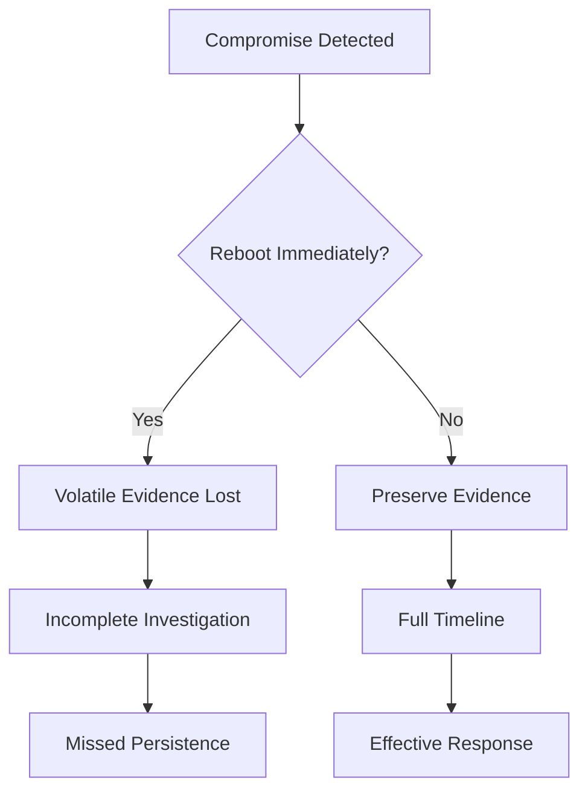
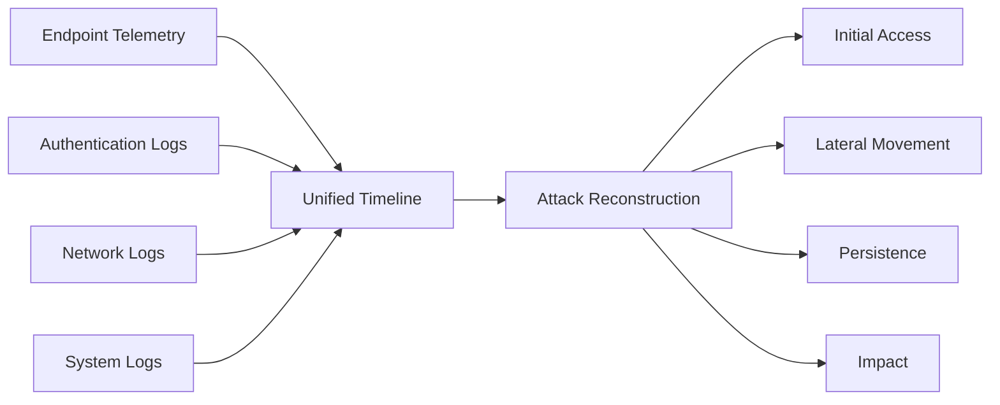

# Incident Response, Scoping, Evidence, and Timelines

Interview questions and answers, grouped by topic. Each source section retains its original content.

---

**Source: 31.md**

## Incident Response Phases: A Defender's Playbook

> **TL;DR** — Incident response is a cycle of decision-making, not just a sequence of steps. Detect → Contain → Eradicate → Recover → Improve.

---

### The Two Frameworks

#### SANS / PICERL (6-Step Model)

The most widely used IR framework in practice:

| # | Phase | Purpose |
|---|---|---|
| 1 | **Preparation** | Build readiness before an attack occurs |
| 2 | **Identification** | Validate the incident, determine scope |
| 3 | **Containment** | Prevent spread and limit blast radius |
| 4 | **Eradication** | Remove threat and close root cause |
| 5 | **Recovery** | Restore systems to a known good state |
| 6 | **Lessons Learned** | Improve detection and response capabilities |

---

#### NIST (4-Phase Model)

NIST groups the same activities into four broader phases:

```
Preparation
  ↓
Detection & Analysis
  ↓
Containment, Eradication & Recovery
  ↓
Post-Incident Activity
```

Both models cover the same ground — SANS is more granular, NIST is more framework-oriented.

---

### Phase-by-Phase Breakdown

#### 1. 🛠️ Preparation — *The Most Critical Phase*

Everything that happens before the alert fires. A weak preparation phase means a blind SOC.

Key activities:
- Establish IR policies and a CSIRT team
- Deploy endpoint sensors (e.g., CrowdStrike Falcon) across all assets
- Configure detection policies, IOAs, and Fusion playbooks
- Build and test playbooks for common scenarios
- Ensure full telemetry visibility — process, network, identity

> **The quality of your response is determined before the incident starts.**

---

#### 2. 🔍 Identification / Detection & Analysis

Triggered by an alert or suspicious event. Goal: determine if it's a true positive, understand scope, and identify the attack stage.

In CrowdStrike Falcon, analysts use:

- **Process Tree** — visualize parent-child execution chains
- **Host Timeline** — chronological view of all activity on a host
- **Event Search** — query raw telemetry for IOCs and behaviors

Falcon generates detections via:
- Behavioral IOAs (not just signatures)
- ML-based anomaly detection
- Threat intelligence correlation

**Key questions at this phase:**
- Is this a true positive?
- What systems are affected?
- What stage of the attack chain are we looking at?

---

#### 3. 🔒 Containment — *The High-Stakes Decision*

Measures to prevent further damage or spread. This is where senior judgment matters most.

**Immediate actions:**
- Host isolation (network quarantine)
- Kill malicious processes
- Block hashes and network indicators

**The containment tradeoff:**

```
Contain too early  →  Lose attacker visibility, miss full scope
Contain too late   →  Attacker spreads, blast radius grows
```

> ⚠️ **Senior signal:** Knowing *when* to contain is as important as *how* to contain.

In mature organizations, threat intelligence informs this decision — understanding adversary intent helps avoid "whack-a-mole" where an attacker simply redeploys assets elsewhere.

---

#### 4. 🧹 Eradication

Remove all attacker presence and close the door behind them.

Checklist:
- Delete malware and malicious files
- Remove persistence mechanisms:
  - Scheduled tasks
  - Registry run keys
  - Malicious services
- Reset all compromised credentials
- Patch exploited vulnerabilities

> Don't skip persistence hunting. Missing a single backdoor means the attacker walks back in after recovery.

---

#### 5. ✅ Recovery

Restore systems to a known good state and validate they're clean before returning to production.

Steps:
- Rebuild or restore from secure, pre-incident backups
- Validate no remaining persistence mechanisms
- Monitor restored systems for abnormal behavior
- Confirm full operational readiness before returning to production

---

#### 6. 📋 Lessons Learned — *Where SOC Maturity Actually Improves*

Post-incident review conducted after the incident is fully resolved.

Outputs:
- Tune detections in Falcon to catch variants of the same attack
- Identify detection gaps and response delays
- Update playbooks and runbooks
- Improve training and awareness programs
- Feed findings back into the Preparation phase

> This phase closes the loop. IR is a **cycle**, not a checklist.

---

### CrowdStrike Falcon Perspective

In Falcon, IR phases are **iterative and overlapping** — especially during active incidents. New telemetry discovered during eradication may send you back to identification.

#### Phase Mapping in Falcon

| IR Phase | Falcon Capability |
|---|---|
| Preparation | Sensor deployment, IOA config, Fusion playbooks |
| Detection | Behavioral detections, ML, Threat Graph |
| Analysis | Process Tree, Host Timeline, Event Search |
| Containment | Host isolation, process kill, hash blocking |
| Eradication | RTR (Real Time Response) for persistence removal |
| Lessons Learned | Detection tuning, policy updates |

---

### Mock Incident: Phishing Chain

**Falcon detects:**
```
winword.exe → powershell.exe → rundll32.exe → network beacon
```

**Detection & Analysis:**
- Confirm phishing-based macro execution
- Identify affected host and user account
- Map to ATT&CK: T1566 (Phishing) → T1059.001 (PowerShell) → T1071 (C2)

**Containment:**
- Isolate host from network
- Kill `rundll32.exe` process and terminate beacon

**Eradication:**
- Remove persistence (registry key, scheduled task)
- Reset user credentials
- Scan environment for similar IOAs on other hosts

**Recovery:**
- Rebuild endpoint from clean image
- Restore user data from backup
- Monitor for recurrence over 72 hours

**Lessons Learned:**
- Add detection rule for `winword.exe → powershell.exe` chains
- Update phishing simulation program
- Improve macro execution policy via GPO

---

### MITRE ATT&CK Mapping

| IR Phase | ATT&CK Focus |
|---|---|
| Detection & Analysis | All tactics — identify attacker behavior patterns |
| Containment | Interrupt TA0008 (Lateral Movement), TA0011 (C2) |
| Eradication | Remove TA0003 (Persistence), TA0006 (Credential Access) artifacts |
| Lessons Learned | Improve detection coverage across the full ATT&CK matrix |

---

### Interview Cheat Sheet

| Strong Signal | Red Flag |
|---|---|
| Explains containment vs. eradication difference | Just lists phases without context |
| Understands the iterative, non-linear nature | Treats IR as a linear checklist |
| Mentions the containment tradeoff | No mention of tradeoffs or judgment calls |
| Connects phases to real decisions | Generic textbook answer |
| References lessons learned feeding back to prep | Stops at recovery |

**What interviewers want to hear:**

> *"Incident response is a cycle of decision-making, not just a sequence of steps. The phases overlap — new information during eradication may change your understanding of scope and send you back to analysis. The containment decision in particular requires judgment: contain too early and you lose visibility into the full attack; contain too late and the attacker has already moved laterally."*

---

### Quick Reference

```
SANS PICERL:
  P → Preparation       (readiness before the alert)
  I → Identification    (validate, scope, triage)
  C → Containment       (limit blast radius)
  E → Eradication       (remove presence + root cause)
  R → Recovery          (restore to known good)
  L → Lessons Learned   (improve for next time)

Key principle:
  IR is a cycle — lessons learned feed back into preparation.

Containment tradeoff:
  Too early = loss of visibility
  Too late  = attacker spreads
```

---

*Tags: `incident-response` `PICERL` `NIST` `blue-team` `crowdstrike` `MITRE` `SOC`*


---

**Source: 32.md**

## Why Containment Comes Before Eradication

> **TL;DR** — You stop the bleeding before performing surgery. Containment limits damage instantly; eradication requires full understanding.

---

### The Core Principle

Containment is prioritized over eradication for three strategic reasons:

1. **Damage control** — Stop attacker progression immediately
2. **Intelligence gathering** — Scope the full intrusion before acting
3. **Prevent adversary retaliation** — Don't tip your hand too early

Attempting to eradicate a threat before fully understanding it leads to what's known as the **"whack-a-mole" problem** — the attacker simply redeploys from a hidden foothold you didn't know existed.

---

### Why Not Eradicate First?

#### The Whack-a-Mole Problem

If you delete malware on Host A without first scoping the environment, you may miss that the attacker:

- Has already moved laterally to Hosts B, C, and D
- Has established persistence via a scheduled task you haven't found yet
- Has a secondary C2 channel you haven't identified

The attacker regains access. The cycle repeats.

---

#### Tipping Your Hand

Sophisticated adversaries **monitor for defensive activity**. If they detect they've been found:

- They may immediately exfiltrate all staged data
- They may deploy ransomware or wipers before you're ready to respond
- They pivot to destructive tactics as a last resort

> Hasty eradication can turn a manageable incident into a catastrophic one.

---

#### Evidence Destruction

Immediate eradication — like pulling the power on a host — destroys **volatile memory (RAM)**, which contains:

- Encryption keys
- Active C2 addresses
- In-memory malware that leaves no disk artifacts

Once that's gone, it's gone.

---

### The Right Order

```
Detect threat
    ↓
Contain (isolate, block, limit movement)
    ↓
Scope fully (all hosts, all persistence, all accounts)
    ↓
Eradicate in a coordinated, simultaneous sweep
    ↓
Recover
```

The key word in that last eradication step is **coordinated** — you remove the attacker from all footholds at once, not one at a time.

---

### CrowdStrike Falcon Perspective

In Falcon, containment is typically the **first decisive action** once a threat is confirmed as a true positive.

#### Falcon Containment Actions

| Action | Purpose |
|---|---|
| Network containment (host isolation) | Cuts attacker's access to the network |
| Kill malicious processes | Stops active execution |
| Block hashes / IOCs | Prevents redeployment on other hosts |
| Disable compromised accounts | Eliminates credential reuse path |

These actions **buy time**, reduce risk, and enable a controlled eradication later.

---

#### Why Eradication Requires Full Context

You cannot safely eradicate until you know:

- ✅ All persistence mechanisms (tasks, registry keys, services)
- ✅ All compromised accounts and credentials
- ✅ All affected hosts across the environment

Eradicating without this means the attacker has a path back in.

---

#### Falcon Example: Containment Breaking the Chain

**Falcon detects:**
```
LSASS access → successful credential dump → lateral movement to 3 servers
```

**Without containment:**
```
Analyst removes malware on Patient Zero
↓
Attacker uses dumped credentials on Server 1, 2, 3
↓
Incident scope triples
```

**With containment:**
```
Analyst isolates Patient Zero at network level
↓
Lateral movement blocked
↓
Analyst scopes all 3 servers safely
↓
Coordinated eradication across all 4 hosts simultaneously
```

Same detection. Completely different outcome.

---

### Mock Incident: The Emotet Mistake

**Scenario:** SOC analyst detects a workstation communicating with a known Emotet C2 server.

#### ❌ The Wrong Path — Eradicate First

1. Analyst deletes the malicious binary
2. Analyst reimages the workstation
3. **What they missed:** The attacker had already moved laterally to three servers
4. The attacker sees their primary tool disappear, knows they're detected
5. Attacker triggers **Ryuk ransomware** across the remaining servers
6. Three servers encrypted. Crisis escalates.

---

#### ✅ The Right Path — Contain First

1. Analyst isolates the workstation at the network level (VLAN isolation)
2. Monitors logs to identify where the workstation attempted to connect
3. Identifies the three compromised servers
4. Isolates all four systems **simultaneously**
5. Full scope established — no hidden footholds remaining
6. Coordinated eradication: all persistence removed across all hosts at once
7. Recovery proceeds from a clean baseline

**Result:** Contained to four hosts. No ransomware. No data loss.

---

### Business Continuity Angle

Containment — not eradication — is what keeps the rest of the business running.

> One isolated host is manageable. Ten compromised servers is a crisis.

Network isolation of affected systems allows:
- Non-affected segments to continue operating
- Investigation to proceed without risk of spread
- Time to plan a proper remediation event

---

### MITRE ATT&CK Mapping

| Phase | Tactics Addressed | How |
|---|---|---|
| **Containment** | TA0008 – Lateral Movement | Network isolation blocks host-to-host movement |
| **Containment** | TA0011 – Command & Control | DNS sinkholes / network blocks cut C2 comms |
| **Containment** | TA0010 – Exfiltration | Egress blocking stops data theft |
| **Eradication** | TA0003 – Persistence | Remove backdoors, tasks, registry keys |
| **Eradication** | TA0006 – Credential Access | Reset compromised accounts and credentials |

---

### Interview Cheat Sheet

| Strong Signal | Red Flag |
|---|---|
| Explains the whack-a-mole risk | "We remove malware immediately" |
| Mentions adversary awareness / retaliation risk | No mention of lateral movement |
| Understands evidence preservation (volatile memory) | Ignores investigation risks |
| Talks about coordinated, simultaneous eradication | Treats eradication as a single-host action |
| References business continuity during containment | Focuses only on the technical steps |

**What interviewers want to hear:**

> *"Containment is prioritized because eradication requires full context you don't have yet. If you eradicate too early, you miss hidden footholds, tip off the attacker, and potentially destroy forensic evidence. The goal of containment is to stop the bleeding and stabilize the environment so you can scope properly — then eradicate everything in one coordinated sweep."*

---

### Quick Reference

```
Containment first because:
  → Stops attacker progression instantly
  → Preserves forensic evidence (RAM, logs)
  → Prevents adversary retaliation / pivot to destruction
  → Buys time to scope fully

Eradication requires knowing:
  → All persistence mechanisms
  → All compromised accounts
  → All affected hosts

The rule:
  Contain → Scope → Eradicate (coordinated) → Recover
```

---

*Tags: `incident-response` `containment` `eradication` `blue-team` `crowdstrike` `MITRE` `SOC` `threat-hunting`*


---

**Source: 33.md**

## When to Isolate a Host — And Why It's Not Always Obvious

> **TL;DR** — Isolation is a strategic decision, not an automatic response. Isolate when risk outweighs visibility and business impact — not just when something looks suspicious.

---

### The Core Tension

Host isolation is one of the most powerful actions in an incident responder's toolkit — and one of the most consequential. Done right, it stops an attacker cold. Done wrong, it:

- Destroys forensic evidence
- Alerts the attacker before you've scoped the incident
- Creates a false sense of containment while the attacker operates elsewhere
- Disrupts critical business operations

> The question isn't *can* you isolate — it's *should* you, and *when*.

---

### When You SHOULD Isolate

#### ✅ 1. Active Lateral Movement

```
LSASS access → credential dump → authentication attempts across multiple servers
```

The attacker is spreading in real time. Every second counts. Isolate immediately to break the movement chain.

---

#### ✅ 2. Ransomware Indicators

Early signs demanding immediate isolation:
- Mass file modifications or unusual extensions appearing
- `vssadmin.exe delete shadows` execution (shadow copy deletion)
- Active encryption processes running

One uncontained host can become a domain-wide encryption event within minutes.

---

#### ✅ 3. Confirmed C2 Communication

- Persistent beaconing to known malicious infrastructure
- Suspicious outbound connections to external IPs
- DNS queries to DGA (Domain Generation Algorithm) domains

Isolation severs the attacker's control channel — they lose the ability to issue commands or exfiltrate data.

---

#### ✅ 4. Privileged Account Compromise

If a Domain Admin account or service account with broad access is actively being used from a compromised host, the blast radius is critical. Isolate immediately — the risk of not acting outweighs everything else.

---

#### ✅ 5. Active Malware Execution

- Process injection into legitimate processes
- Persistence creation (new services, scheduled tasks, registry keys)
- Lateral tool deployment via WMI or PsExec

---

### When You Should Pause Before Isolating

Not every confirmed threat demands instant isolation. Senior responders ask:

```
Is the attacker actively spreading or causing damage right now?
  → If yes: Isolate.

Is the host mission-critical to business operations?
  → If yes: Coordinate with business owners first.

Have we scoped all affected systems?
  → If no: Consider monitoring briefly before simultaneous isolation.

Will isolation help or hinder the investigation?
  → Consider VLAN isolation over full network kill.
```

---

### Risks of Immediate Isolation

#### ⚠️ 1. Forensic Evidence Loss

Hard-isolating a system (pulling the power) destroys **volatile memory (RAM)**, which contains:

| Artifact | Significance |
|---|---|
| Encryption keys | Required to decrypt ransomed files |
| C2 IP addresses | Reveals attacker infrastructure |
| Injected malicious threads | Fileless malware leaves no disk artifacts |
| Active session tokens | Proves credential reuse |

**The correct approach:** Use logical/network isolation (EDR-based containment) — the host stays powered on for live forensics, but the attacker loses network access.

---

#### ⚠️ 2. Alerting the Attacker

Sophisticated adversaries monitor their connections. A sudden network drop signals detection. They may:

- Accelerate the attack before remaining access is cut
- Activate backup C2 channels or secondary implants
- Switch TTPs to evade further discovery
- Trigger a "scorched earth" payload — wipers, ransomware, bulk exfiltration

> Premature isolation can turn a manageable incident into a destructive one.

---

#### ⚠️ 3. The Whack-a-Mole Effect

Isolating one host before scoping the environment creates a false sense of containment. If the attacker has already moved laterally:

```
You isolate Host A
Attacker is still active on Hosts B, C, D
They redeploy from a foothold you didn't know about
Cycle repeats
```

The fix: scope first, then isolate **all affected hosts simultaneously**.

---

#### ⚠️ 4. Business Disruption

For mission-critical assets — production servers, domain controllers, OT/ICS systems — isolation may cause more operational damage than the malware itself. This decision requires:

- Coordination with system and business owners
- Understanding of downstream dependencies
- An agreed-upon RTO (Recovery Time Objective)

---

### CrowdStrike Falcon: Network Containment

In Falcon, **Network Containment** (host isolation) is the standard tool for this action. It:

- Blocks all inbound and outbound traffic
- Maintains communication **only** with the Falcon cloud
- Keeps the host powered on for live response and forensics via RTR (Real Time Response)

This is the critical difference from pulling a cable — the host is isolated from the attacker, but the analyst retains full access.

#### Falcon Isolation Workflow

```
True Positive confirmed
    ↓
Assess: Is attacker spreading? Is host critical?
    ↓
Apply Network Containment via Falcon console
    ↓
Host isolated — analyst retains RTR access
    ↓
Conduct live forensics (memory, processes, persistence)
    ↓
Scope environment for additional compromised hosts
    ↓
Simultaneous coordinated isolation of all affected hosts
```

---

### Mock Incident: The Ryuk Decision

**Falcon alert:**
```
powershell.exe → vssadmin.exe delete shadows → connection to known Ryuk C2 IP
```

**Triage findings:**
- Script attempting shadow copy deletion
- Ransomware deployment appears imminent

**Option A — Pull the power:**
- ❌ Destroys RAM — Ryuk encryption keys lost
- ❌ No live forensics possible
- ❌ Cannot recover files if encryption already started

**Option B — Logical isolation via Falcon:**
- ✅ Network access severed — attacker loses C2
- ✅ Host stays on — live forensics proceed via RTR
- ✅ Analyst scopes environment for other hosts talking to same C2 IP
- ✅ Simultaneous containment of the full "herd"

**Outcome:** Ransomware stopped. Encryption keys preserved in RAM. Full incident scope identified before eradication.

---

### Mock Incident: The Lateral Movement Dilemma

**Falcon shows:**
```
powershell.exe → LSASS access → service account authenticates to 6 servers
```

| Option | Action | Risk |
|---|---|---|
| **A — Immediate isolation** | Isolate source host now | Stops spread but loses visibility into 6 servers |
| **B — Brief monitoring** | Watch for 10–15 min, identify all affected hosts | Risk of further spread if attacker moves fast |
| **B+ — Coordinated isolation** | Isolate all 7 systems simultaneously | Best outcome — full containment, minimal gaps |

**Senior decision factors:**
- How fast is the attacker moving?
- Are the 6 servers already compromised or just targeted?
- Is the service account being used for further privilege escalation?

---

### MITRE ATT&CK Mapping

| Action | Tactic Disrupted | How |
|---|---|---|
| Host isolation | TA0008 – Lateral Movement | Breaks RDP, SMB, WMI paths |
| Host isolation | TA0011 – Command & Control | Severs attacker's control channel |
| Host isolation | TA0040 – Impact | Prevents ransomware deployment |
| **Premature** isolation | TA0003 – Persistence | May miss hidden backdoors |
| **Premature** isolation | TA0006 – Credential Access | Incomplete scope of compromised accounts |

---

### Interview Cheat Sheet

| Strong Signal | Red Flag |
|---|---|
| Mentions isolation method matters (logical vs. power) | "Always isolate compromised hosts immediately" |
| Understands volatile memory and forensic risk | No mention of evidence preservation |
| Talks about coordinated simultaneous isolation | Isolating one host at a time |
| Considers business impact and system criticality | No mention of operational risk |
| Knows attacker reacts to defensive actions | Treats isolation as a purely technical step |

**What interviewers want to hear:**

> *"Isolation should be triggered when there's high-confidence active compromise with risk of spread — ransomware activity, confirmed lateral movement, or active C2. But it's a strategic decision, not a reflex. The isolation method matters — logical containment via EDR preserves volatile memory for forensics, unlike pulling the power. And ideally, you scope the full environment first so you can isolate all affected hosts simultaneously, rather than tipping off the attacker by isolating one at a time."*

---

### Quick Reference

```
ISOLATE WHEN:
  → Active lateral movement detected
  → Ransomware indicators (shadow copy deletion, mass encryption)
  → Confirmed C2 beaconing
  → Privileged account actively compromised
  → Malware actively executing with spread potential

PAUSE AND ASSESS WHEN:
  → Host is mission-critical (coordinate with business)
  → Scope is not yet established (risk of whack-a-mole)
  → Monitoring will reveal additional footholds

ISOLATION METHOD:
  → Logical/network isolation (EDR) = preserves RAM, retains analyst access
  → Pulling power = destroys volatile evidence (avoid unless necessary)

GOLDEN RULE:
  → Scope fully → isolate all affected hosts simultaneously
```

---

*Tags: `incident-response` `containment` `host-isolation` `blue-team` `crowdstrike` `MITRE` `SOC` `forensics`*


---

**Source: 34.md**

## Scoping: Why It Determines Whether You Actually Solved the Incident

> **TL;DR** — If you don't scope correctly, you don't actually contain the incident. You just treat a symptom while the attacker operates elsewhere.

---

### What Is Scoping?

Scoping is the process of determining the **full breadth and depth** of a security incident — which systems, users, accounts, data, and timeframes are affected.

It transitions a response from *"we found something suspicious on one host"* to *"we understand the entire intrusion."*

Scoping answers five questions:

```
1. Which hosts are compromised?
2. Which accounts and identities are involved?
3. What techniques and persistence mechanisms did the attacker use?
4. When did the attack start — and how long have they been present?
5. Where did the attacker move after initial access?
```

Without answers to all five, any containment or eradication effort is incomplete.

---

### Why Scoping Is Critical

#### 1. Prevents Partial Containment

Most attacks are not limited to a single machine. If you isolate Host A without scoping:

```
You isolate Host A
Attacker is already active on Hosts B, C, D
Incident continues undetected
```

Partial containment is not containment — it's a false sense of resolution.

---

#### 2. Prevents the Whack-a-Mole Cycle

Without full scoping, eradication is temporary. The attacker redeploys from a foothold you didn't know about. You find it, remove it. They redeploy again. The cycle repeats — and every iteration costs time, money, and trust.

> Scoping ensures that when you move to eradication, you remove the attacker from **every** foothold **simultaneously**.

---

#### 3. Determines Business Impact

Scoping answers the questions leadership will immediately ask:

- Was sensitive data accessed or exfiltrated?
- Were customer systems or data affected?
- Which critical systems were compromised?
- How long was the attacker present (dwell time)?

Without scoping, you cannot answer these accurately.

---

#### 4. Drives the Correct Response Strategy

| Scope of Incident | Response Type |
|---|---|
| Single host, no lateral movement | Targeted containment and remediation |
| Multiple hosts, credential compromise | Coordinated multi-system response |
| Domain-wide, privileged access | Major incident / crisis response team |
| Data exfiltration confirmed | Legal, compliance, and notification involvement |

Scoping tells you which playbook to run.

---

### The Five Dimensions of Scope

#### 🖥️ 1. Host Scope
*Which endpoints are affected?*

- Cross-host detection correlation (same hash, same command seen across machines)
- Host timeline analysis for each suspicious system
- EDR sweep for matching IOCs across the environment

---

#### 👤 2. Identity Scope
*Which accounts are involved?*

Look for:
- Same user account active across multiple hosts
- Service account anomalies — interactive logins, unusual hours
- Privileged account usage from non-PAW systems
- Credential reuse patterns after a dump event

> Identity scope is often underestimated. A compromised service account with domain-wide permissions changes the entire severity calculation.

---

#### ⚙️ 3. Process / Behavior Scope
*What techniques did the attacker use?*

Map out:
- Full execution chains (parent → child process trees)
- Persistence mechanisms created (tasks, services, registry keys, WMI)
- Credential access events (LSASS reads, SAM access, DCSync)
- Tools deployed (LOLBins, offensive frameworks, custom malware)

This is where ATT&CK mapping becomes actionable — not just academic.

---

#### 🕐 4. Time Scope — *The Most Underrated Dimension*
*When did this actually start?*

Dwell time determines:
- How much data the attacker had access to
- How many systems were potentially touched
- Whether regulatory notification windows apply
- The true starting point for forensic evidence collection

> Attackers rarely announce themselves on Day 1. The "detection date" and the "compromise date" are almost never the same.

---

#### 🔀 5. Lateral Movement Scope
*Where did the attacker go after initial access?*

Trace:
- Authentication logs across the environment (successful logins from the compromised account)
- Remote execution events (PsExec, WMI, WinRM, RDP)
- Network flows from the initially compromised host
- New scheduled tasks or services created on remote systems

---

### CrowdStrike Falcon: Scoping in Practice

In Falcon, scoping is **continuous** — not a one-time step. New telemetry during investigation can expand scope at any point.

#### Key Falcon Tools for Scoping

| Tool | Scoping Use |
|---|---|
| **Host Timeline** | Chronological view of all activity on a single host |
| **Event Search** | Query raw telemetry across all endpoints (same hash, same command) |
| **Detection Correlation** | Surface related detections across hosts |
| **Falcon XDR** | Correlate identity activity across endpoints and cloud |
| **Process Tree** | Visualize full execution chain from initial access onward |

---

#### Scoping Workflow in Falcon

```
Detection on Host A (LSASS access)
    ↓
Query Event Search: same user account on other hosts?
    ↓
Host Timeline on Hosts B, C, D: confirm activity
    ↓
Check for persistence: scheduled tasks, new services
    ↓
Identity scope: service account used post-dump?
    ↓
Time scope: when was the first anomalous event?
    ↓
Full picture established → coordinated containment
```

---

### Mock Incident: The DNS Pivot

**Initial detection:** Single workstation communicating with a known-malicious IP.

#### ❌ Wrong Response — Isolate Immediately

1. Analyst isolates the workstation
2. Analyst wipes it
3. **What they missed:** The same malicious C2 domain had been resolved by three other servers in the environment
4. Attacker, realizing their primary foothold is gone, activates backup persistence on the other servers
5. Exfiltration begins from Server 2

---

#### ✅ Right Response — Scope First

1. Analyst searches DNS logs for **all systems** that resolved the malicious domain
2. Analyst checks NetFlow data for any other hosts communicating with the malicious IP
3. Discovers three additional compromised servers
4. Scopes identity: which accounts authenticated across all four systems?
5. Confirms service account lateral movement path
6. **Simultaneous containment** of all four systems
7. Full eradication with no remaining footholds

**Result:** Complete incident resolution on first attempt. No whack-a-mole.

---

### Mock Incident: The Expanding Blast Radius

**Falcon detects:**
```
powershell.exe → LSASS access (Host A)
```

**Initial assumption:** Single host compromise.

**Scoping reveals:**

| Finding | Significance |
|---|---|
| Same user account logged into Hosts B, C, D | Lateral movement via credential reuse |
| Service account activity across 3 servers | Privilege escalation path used |
| Scheduled task created on Host C | Persistence established |
| LSASS access on Host D | Credential access attempt repeated |

**Without scoping:** Only Host A isolated → attacker persists on B, C, D with a scheduled task ensuring re-entry.

**With scoping:** All five systems contained simultaneously. Scheduled task identified and removed. Service account reset as part of coordinated eradication.

---

### MITRE ATT&CK Mapping

Scoping is the defender activity that **uncovers** attacker techniques. Without it, your ATT&CK mapping is incomplete — and so is your response.

| What Scoping Uncovers | ATT&CK Tactic |
|---|---|
| Attacker's internal reconnaissance | TA0007 – Discovery |
| Host-to-host movement paths | TA0008 – Lateral Movement |
| Backdoors, tasks, registry persistence | TA0003 – Persistence |
| Credential dump events and reuse | TA0006 – Credential Access |
| How close attacker is to final goal | TA0040 – Impact |

> Without scoping, ATT&CK mapping is incomplete and misleading.

---

### Interview Cheat Sheet

| Strong Signal | Red Flag |
|---|---|
| Mentions breadth *and* depth — hosts, users, timeline | "Find the affected systems" (too shallow) |
| Understands scoping is continuous, not one-time | Treating scoping as a checkbox |
| Connects scoping to eradication effectiveness | No mention of identity or time scope |
| Brings up dwell time and its implications | Ignoring when the attack actually started |
| Mentions simultaneous coordinated eradication as the goal | Thinks one host at a time is sufficient |

**What interviewers want to hear:**

> *"Scoping is the systematic identification of all compromised hosts, accounts, persistence mechanisms, and the full timeline of an intrusion. It's critical because without it, any containment or eradication effort is likely incomplete. The goal is to avoid the whack-a-mole cycle — you scope fully first, then eradicate everything simultaneously. In Falcon, scoping is continuous — new telemetry during the investigation can expand your understanding of scope at any point."*

---

### Quick Reference

```
5 Dimensions of Scope:
  1. Host scope     → Which systems?
  2. Identity scope → Which accounts?
  3. Behavior scope → What techniques and persistence?
  4. Time scope     → When did it start? Dwell time?
  5. Movement scope → Where did the attacker go?

Scoping tools in Falcon:
  → Event Search (cross-host IOC hunting)
  → Host Timeline (per-host chronology)
  → Detection Correlation (related alerts)
  → Process Tree (execution chain)
  → Falcon XDR (identity + endpoint correlation)

The rule:
  Scope fully → contain all at once → eradicate completely
  
If you skip scoping:
  → Partial containment
  → Attacker persists
  → Incident reopens
```

---

*Tags: `incident-response` `scoping` `blue-team` `crowdstrike` `lateral-movement` `MITRE` `SOC` `threat-hunting`*


---

**Source: 35.md**

## Evidence Preservation & Why Not Reboot Immediately

### Evidence Preservation

Evidence preservation is the process of protecting and maintaining data integrity for investigation and response.

#### Key Evidence Types

- Memory artifacts
- Process execution data
- Logs and timelines
- Disk artifacts

#### CrowdStrike Perspective

Falcon preserves:

- Process Tree
- Command-line arguments
- Memory behavior (e.g., LSASS access)
- DLL loads (ImageLoad)
- Network connections
- Event timelines

---

### Evidence Types & Risk

| Type           | Example                  | Risk if Lost        |
|----------------|--------------------------|--------------------|
| Volatile       | Memory, processes        | Lost on reboot     |
| Semi-volatile  | Logs, temp files         | Overwritten        |
| Persistent     | Disk files               | Can be deleted     |

---

### Evidence Lifecycle



---

### Why You Should NOT Reboot Immediately

Rebooting destroys volatile evidence and disrupts investigation.

#### What is Lost

- In-memory malware
- Injected processes
- Active network connections
- Credential artifacts (LSASS, tokens, hashes)

#### Impact

- Breaks attack timeline
- Hides attacker activity
- Allows persistence to restart

---

### Example

```
powershell.exe → injected payload → LSASS access
```

After reboot:
- Payload gone
- Evidence gone
- Partial visibility

---

### Falcon Approach

Before reboot:

- Capture:
  - Process Tree
  - Timeline
  - Memory indicators

- Use:
  - Real Time Response (RTR)
  - Remote triage

- Perform:
  - Cross-host scoping

Then:
- Controlled containment
- Remediation

---

### Reboot vs Preserve Decision



---

### Interview Notes

- Order of volatility (RAM first)
- Hash validation (SHA-256)
- RAM-only malware awareness
- Adversary OPSEC considerations
- SSD TRIM risk

---

### Key Takeaway

- Do not reboot immediately
- Preserve volatile evidence first
- Investigate before containment


---

**Source: 36.md**

## Data Sources for Building an Attack Timeline

### Core Concept

An attack timeline is built by correlating endpoint, identity, network, and system logs to reconstruct what happened, when, and in what sequence.

---

### Primary Data Sources

#### 1. Endpoint Telemetry (Primary Source)

- Process execution (ProcessRollup2)
- Command-line arguments
- Parent-child relationships
- DLL loads (ImageLoad)
- Memory behavior (LSASS access, injection)
- File activity

---

#### 2. Host Timeline (Falcon)

- Chronological view of:
  - Processes
  - Detections
  - Network events

Used to determine:
- What happened first
- Event chaining

---

#### 3. Identity / Authentication Logs

Sources:
- Active Directory
- Azure AD / Entra ID
- VPN logs

Data:
- Login times
- Source IP/location
- Account usage

Use cases:
- Account compromise detection
- Lateral movement tracking

---

#### 4. Network Telemetry

- Outbound connections
- Internal communication (SMB, RDP, WinRM)

Use cases:
- Command & Control (C2)
- Data exfiltration
- Lateral movement paths

---

#### 5. Windows Event Logs

- Security logs (4624, 4625, 4672)
- Service creation
- Scheduled tasks
- Logon events

Use cases:
- Authentication tracking
- Privilege escalation
- Persistence detection

---

#### 6. Cloud / SaaS Logs

- O365 / Azure / AWS logs
- API activity
- Token usage

Use cases:
- Session hijacking
- Identity attacks

---

### Timeline Correlation Model


### CrowdStrike-Style Timeline Example

```
10:01 → winword.exe launches powershell.exe
10:02 → encoded PowerShell execution
10:03 → LSASS access detected
10:05 → same user logs into server
10:07 → service created on server
```

#### Data Sources Used

- Endpoint → execution chain
- Identity → login events
- System logs → service creation

#### SOC Conclusion

Phishing → execution → credential theft → lateral movement → persistence

---

### Advanced Timeline Sources

#### Host-Based Artifacts

- Windows Event Logs (4624, 4688)
- Prefetch
- ShimCache
- Amcache

---

#### Filesystem Metadata

- $MFT
- USN Journal
- $LogFile

Use:
- File creation
- File deletion
- Rename tracking

---

#### User Activity Artifacts

- ShellBags
- LNK files
- Browser history

---

#### Network Logs

- Firewall logs
- Proxy logs
- DNS logs
- NetFlow

---

### Interview Key Concepts

- Super Timeline (correlate multiple sources)
- Order of Volatility (memory first)
- Pivot Points (anchor event)
- Anti-forensics (timestomping detection)

---

### Summary Table

| Category              | Sources                          | Value |
|----------------------|----------------------------------|------|
| Host Logs            | Security, Sysmon, PowerShell     | Auth, execution tracking |
| Execution Artifacts  | Prefetch, ShimCache, Amcache     | Execution timing |
| Filesystem Metadata  | MFT, USN Journal                 | File activity history |
| User Activity        | ShellBags, LNK                   | User behavior |
| Network Telemetry    | DNS, Proxy, Firewall             | External communication |

---

### Key Takeaway

- No single log is enough
- Correlation = visibility
- Timeline = story of the attack

