# Detection Engineering, SIEM, and Coverage

Interview questions and answers, grouped by topic. Each source section retains its original content.

---

**Source: 37.md**

## What is an IOC and why are IOCs insufficient?

### Definition

An Indicator of Compromise (IOC) is a specific observable artifact that suggests malicious activity.

Examples:
- File hashes
- IP addresses
- Domain names
- File paths

---

### Key Idea

IOCs tell you **something happened**, but not:
- What exactly happened
- Why it happened
- How serious it is

---

### Why IOCs Are Insufficient

#### 1. Easily Changed
- Malware can be recompiled → new hash
- Infrastructure can rotate → new IP/domain

---

#### 2. No Context

Example:
powershell.exe → connects to IP

Unknown:
- Was it malicious?
- Was it admin activity?

---

#### 3. Misses Modern Attacks

- Fileless malware
- Living-off-the-Land (LOLBins)
- In-memory execution

No file → no hash → no IOC

---

#### 4. Reactive Only

- Detects known threats
- Fails against:
  - New malware
  - Custom tools
  - Zero-days

---

### CrowdStrike Perspective

IOCs = supporting signals  
IOAs = primary detection

Falcon focuses on:
- Process behavior
- Command-line activity
- Parent-child relationships
- Memory access

---

### Example (Behavior-Based Detection)

winword.exe → powershell.exe → encoded command → LSASS access

- No IOC required
- Behavior proves compromise

---

### Mermaid: IOC vs Behavior Detection

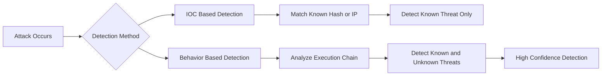

---

### Mock Scenario

#### IOC-Based Failure
- No hash match found
- Analyst assumes system is safe

Reality:
- Malware is polymorphic
- Hash changes every time

---

#### Behavior-Based Success

Detection:
vssadmin.exe delete shadows

Outcome:
- Attack detected during execution
- True positive confirmed

---

### Key Takeaway

- IOCs are **reactive**
- IOAs are **behavioral**
- Detection must focus on **how attackers operate**, not just artifacts

---

**Source: 38.md**

## SIEM, Log Normalization, Correlation Rules & Telemetry Blind Spots

### What is a SIEM?

A SIEM collects, normalizes, correlates, and analyzes logs from multiple sources.

It solves:
- Fragmented visibility
- Manual log analysis
- Lack of centralized detection

---

### Mermaid: SIEM Role

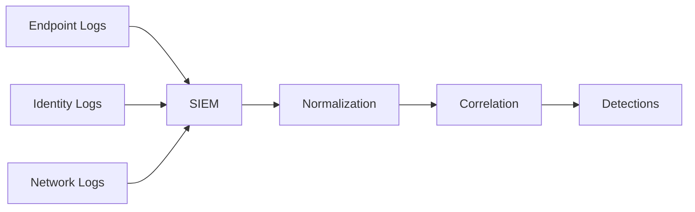

---

### What is Log Normalization?

Log normalization converts different log formats into a standard structure.

Example:
- user=admin
- username=admin
- usr=admin

→ normalized → user=admin

---

### Mermaid: Normalization

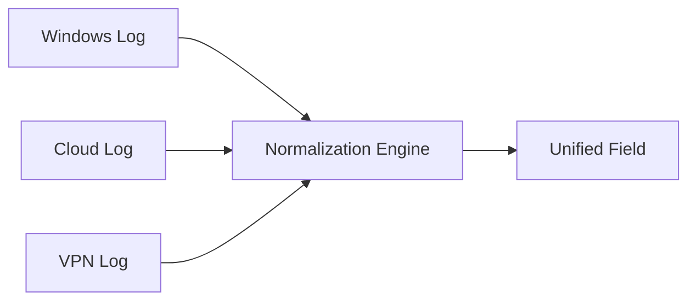

---

### What is a Correlation Rule?

A correlation rule links multiple events to detect attack patterns.

Example:
- PowerShell execution
- LSASS access
- New login

→ Combined → Incident

---

### Mermaid: Correlation

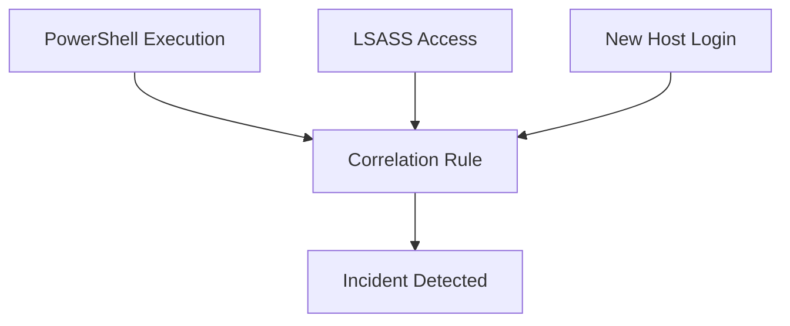

---

### Why Missing Telemetry Creates Blind Spots

Missing telemetry means missing visibility.

You cannot detect what you cannot see.

---

### Examples

#### No Endpoint Data
- No process visibility
- No command-line visibility
- No memory detection

---

#### No Identity Data
- No login tracking
- No credential abuse detection

---

#### No Network Data
- No C2 detection
- No exfiltration detection

---

### Mermaid: Blind Spot

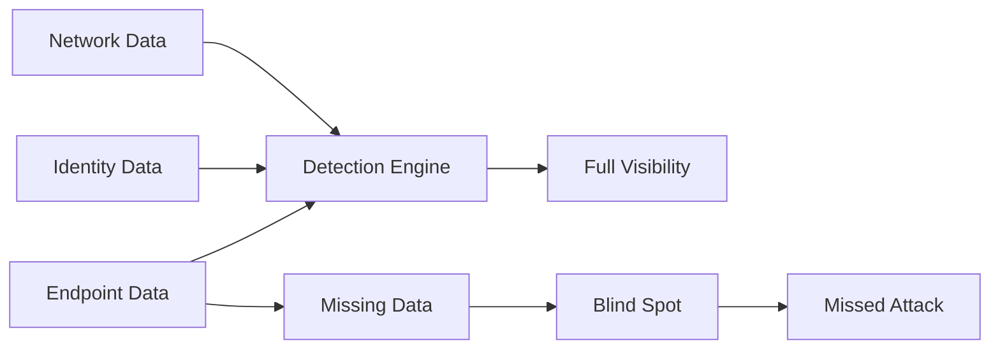

---

### Key Takeaway

- SIEM = aggregation + normalization + correlation
- Normalization = standard format
- Correlation = attack detection logic
- Missing telemetry = blind spots

---

**Source: 39.md**

## Static Detection vs Behavioral Detection (Full Notes)

### Why do static detections fail over time?

Static detections, also known as signature-based detections, rely on databases of known attack patterns, file hashes, or vulnerabilities. They fail over time because they can only identify threats for which a specific signature has already been created.

Because the threat landscape evolves rapidly, vendors must constantly discover new malware, extract signatures, and distribute updates. If a signature database is outdated, or if attackers use zero-day exploits, static detection fails completely.

---

### What is behavioral detection?

Behavioral detection is a proactive approach that observes how a program executes rather than matching static code.

It analyzes:
- Process behavior
- System changes
- Execution patterns

It detects:
- Code unpacking
- Host file modification
- Keystroke monitoring

Because it focuses on actions and intent, it can detect unknown threats without signatures.

---

### Why do attackers evade signature-based detection?

Attackers evade signature-based detection because:
- It is brittle
- Small changes break detection

Techniques used:
- Polymorphic malware (changes every execution)
- Code obfuscation
- Payload testing against AV/EDR

Attackers often validate payloads before deployment to ensure they are undetectable.

---

## Deep SOC / IR View

### Why static detections fail

Static detections rely on:
- Hashes
- IPs
- Domains
- Signatures

#### Key Insight
Artifacts change quickly  
Techniques remain consistent

---

### CrowdStrike Perspective

Static detections are:
- Low durability
- Easily evaded
- Supportive, not primary

---

### Real SOC Examples

#### 1. Recompilation

malware_v1.exe → hash A (detected)  
malware_v2.exe → hash B (undetected)

---

#### 2. Infrastructure Rotation

- Change IP/domain → IOC invalid
- Use cloud/CDN → harder to block

---

#### 3. Fileless Attacks

- No file
- No hash
- No signature

---

### Mermaid: Why Static Detection Fails

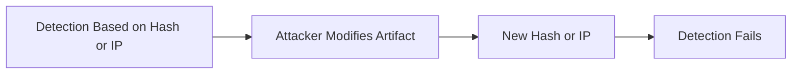

---

## Behavioral Detection

Behavioral detection identifies threats based on actions, not files.

Focus areas:
- Process chains
- Command-line activity
- Memory access
- Privilege usage

---

### CrowdStrike Perspective

Falcon uses IOAs (Indicators of Attack)

#### Example

winword.exe → powershell.exe (encoded) → lsass.exe access

- No IOC required
- Behavior proves compromise

---

### Comparison

| Static Detection | Behavioral Detection |
|-----------------|---------------------|
| What it is | What it does |
| Fragile | Durable |
| Reactive | Proactive |
| Easy to evade | Hard to evade |

---

### Mermaid: Behavioral Detection

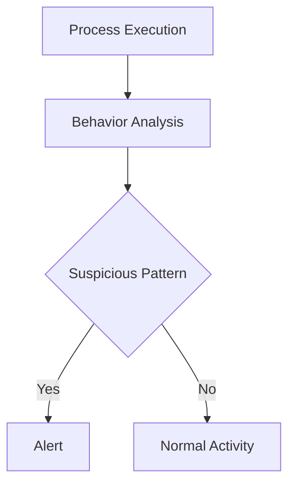

---

## Why attackers evade signature-based detection

### Model Answer

Attackers evade signature-based detection because:
- It is predictable
- It is artifact-based
- It is easy to bypass with minor changes

---

### CrowdStrike Perspective

Modern attackers design operations specifically to avoid static detection.

---

### How attackers evade

#### 1. Modify Artifacts

- Change hash → bypass AV
- Change domain → bypass IOC

---

#### 2. Use LOLBins

- powershell.exe
- rundll32.exe
- mshta.exe

No malware required → no signature

---

#### 3. Fileless Techniques

- In-memory execution
- Reflective DLL loading
- Token abuse

---

#### 4. Pre-Test Payloads

Attackers test against:
- AV engines
- EDR sandboxes

Only deploy when undetected

---

### Mermaid: Attacker Evasion Loop

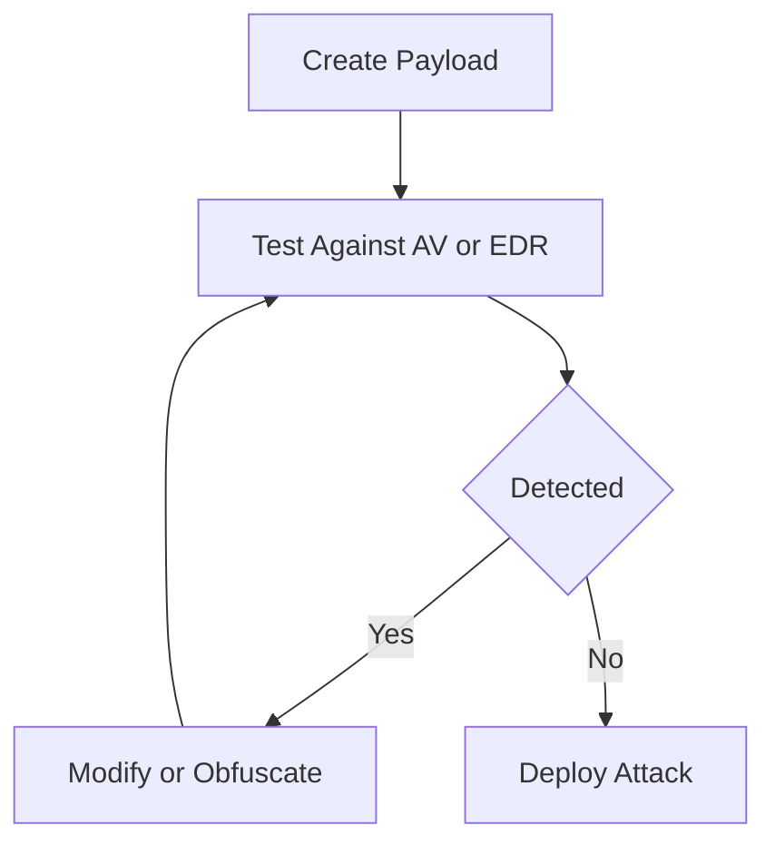

---

### Final Takeaway

- Static detection is fragile and reactive
- Behavioral detection is durable and proactive
- Modern SOC must focus on attacker behavior, not artifacts

---

**Source: 40.md**

## Detection Gaps, MITRE ATT&CK Mapping, and Detection Coverage vs Quality

---

### What is a Detection Gap?

#### Definition (Interview Answer)
A detection gap is a lack of visibility or detection capability for a specific attacker behavior or technique, meaning an attacker can perform that activity without triggering any alert.

In short:
A detection gap is where attackers can operate undetected.

---

### Deep Explanation

A detection gap is a blind spot in an organization's security posture where preventive or detective controls fail to identify a specific attack vector or adversary behavior. These gaps occur when:
- There is inadequate logging visibility
- Detection rules do not account for new attack techniques
- Security tools are improperly configured

Security teams proactively discover these gaps through:
- Threat hunting
- Red team adversary emulation
- Continuous security validation

Once identified, gaps must be remediated by:
- Creating new detection rules
- Acquiring required telemetry
- Mitigating risk via hunting or controls

---

### Key Concepts
- Visibility gaps = no telemetry
- Logic gaps = no detection rule
- Design gaps = weak or noisy detections

---

### CrowdStrike Perspective

Detection gaps in Falcon typically arise from:

#### 1. Missing Telemetry
- No process logging
- No command-line visibility
- No identity logs  
→ You cannot see the attack

#### 2. Missing Detection Logic
- Data exists, but:
  - No IOA
  - No rule
  - No correlation

#### 3. Weak Detection Design
- Too noisy → disabled
- Too narrow → bypassed

---

### Example / Scenario

Attack:
rundll32.exe → malicious.dll (AppData)

If:
- No DLL load visibility
- No rule for suspicious path

Result:
Silent execution → Detection gap

---

### Mermaid: Detection Gap

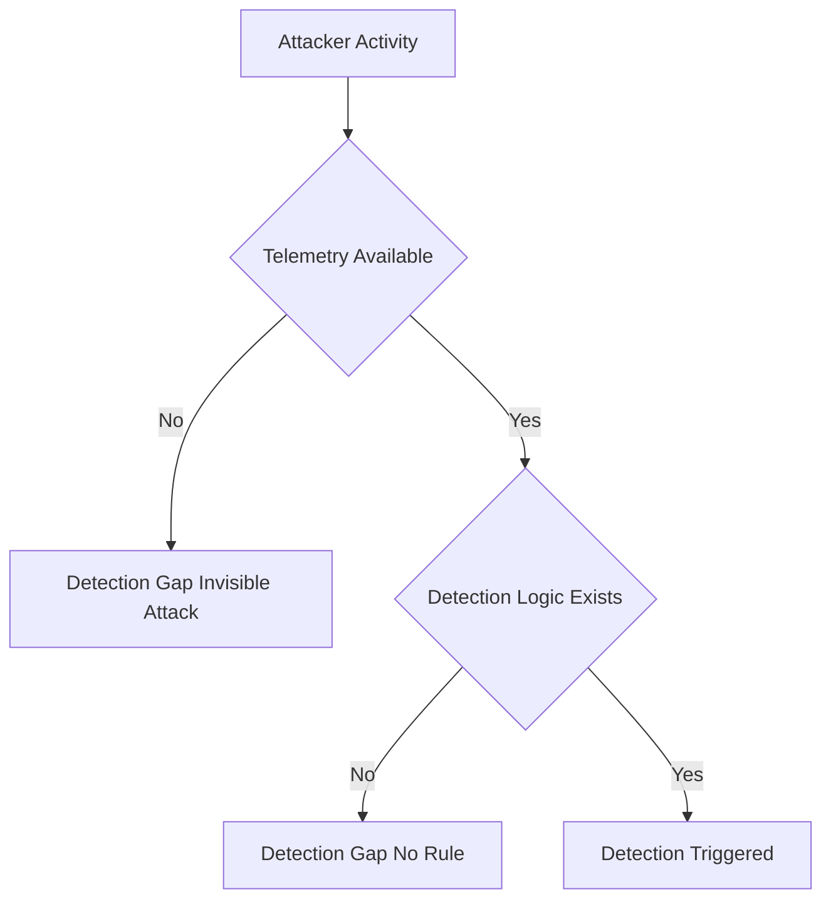

---

### Detection / Investigation Notes
- Always ask: “Do we even see this?”
- Then: “Do we detect it?”
- Gaps often exist in:
  - Identity logs
  - Command-line visibility
  - Cross-host correlation

---

### Key Takeaway
- Detection gaps are inevitable
- Mature SOCs proactively find and close them
- Visibility + logic = detection

---

## Why Map Detections to MITRE ATT&CK?

#### Definition (Interview Answer)
Mapping detections to MITRE ATT&CK provides a standardized way to measure detection coverage against real adversary techniques.

In short:
MITRE mapping turns detection into measurable coverage.

---

### Deep Explanation

MITRE ATT&CK provides a universal language based on real-world attacker behavior (TTPs). Mapping detections to ATT&CK allows organizations to:
- Understand what techniques they detect
- Identify what techniques they miss
- Align threat intelligence, red team, and blue team

It transforms detection into a strategic, measurable program.

---

### Key Concepts
- ATT&CK = adversary behavior model
- Mapping = visibility of strengths & gaps
- Not a checklist — a framework for strategy

---

### CrowdStrike Perspective

Falcon aligns detections to ATT&CK to enable:

#### 1. Coverage Visibility
- Can we detect:
  - Credential dumping?
  - Lateral movement?
  - Persistence?

#### 2. Gap Identification
Example:
No detection for T1003 → critical gap

#### 3. Standardized Language
- SOC, IR, Red Team, Threat Intel use same vocabulary

#### 4. Detection Maturity
- Move from tool-based → adversary-based detection

---

### Example / Scenario

Red team executes:
- Credential dumping (T1003)

Blue team:
- Detects execution
- Misses credential access

Result:
Gap identified → detection created

---

### Mermaid: MITRE Mapping

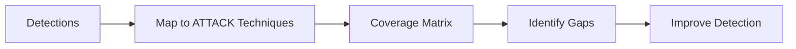

---

### Detection / Investigation Notes
- Always map detections to ATT&CK technique IDs
- Helps prioritize high-risk gaps
- Enables measurable security posture

---

### Key Takeaway
- Without ATT&CK mapping, you don’t know what you’re missing
- Mapping enables structured detection engineering
- It aligns all security teams

---

## Detection Coverage vs Detection Quality

#### Definition (Interview Answer)
Detection coverage is the breadth of techniques you can detect, while detection quality is how accurately and effectively those detections work.

In short:
Coverage is breadth; quality is depth.

---

### Deep Explanation

Detection coverage:
- Measures how many ATT&CK techniques are covered
- Focuses on visibility across environment

Detection quality:
- Measures accuracy and usefulness
- Focuses on:
  - True positives
  - Low false positives
  - Context-rich alerts

An organization may have:
- High coverage but poor quality → alert fatigue
- High quality but low coverage → missed attacks

---

### Key Concepts
- Coverage = scope
- Quality = fidelity
- Both must be balanced

---

### CrowdStrike Perspective

#### Detection Coverage (Breadth)
- % of ATT&CK techniques covered
- Wide visibility reduces blind spots

#### Detection Quality (Depth)
- Accuracy
- Context
- Actionability
- Confidence

---

### Example / Scenario

| Scenario | Coverage | Quality |
|---------|---------|--------|
| Alert on powershell.exe | High | Low |
| Encoded PS + parent + LSASS | Medium | High |

---

### Mermaid: Coverage vs Quality

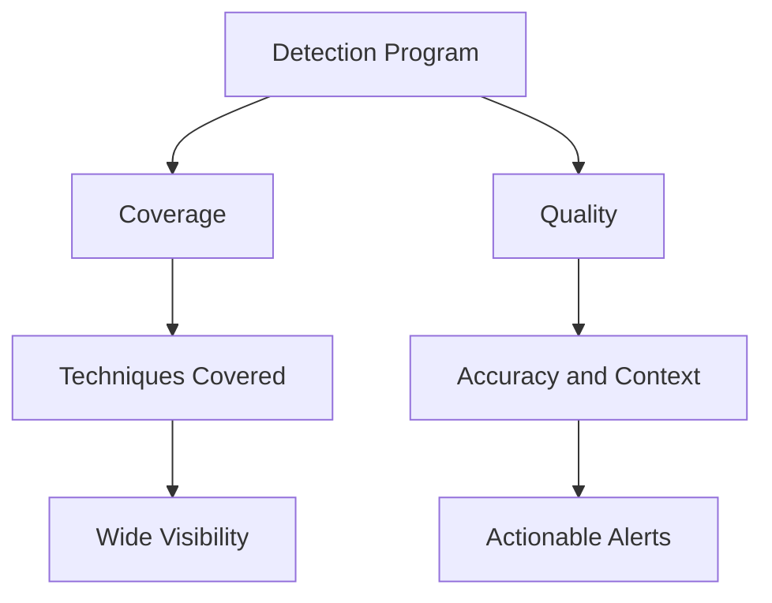

---

### Detection / Investigation Notes
- High noise = poor quality
- Missing techniques = poor coverage
- Best detections:
  - Context-rich
  - Behavior-based
  - Low false positives

---

### Key Takeaway
- High coverage + low quality = alert fatigue
- Low coverage + high quality = missed attacks
- Goal: High coverage + high quality

